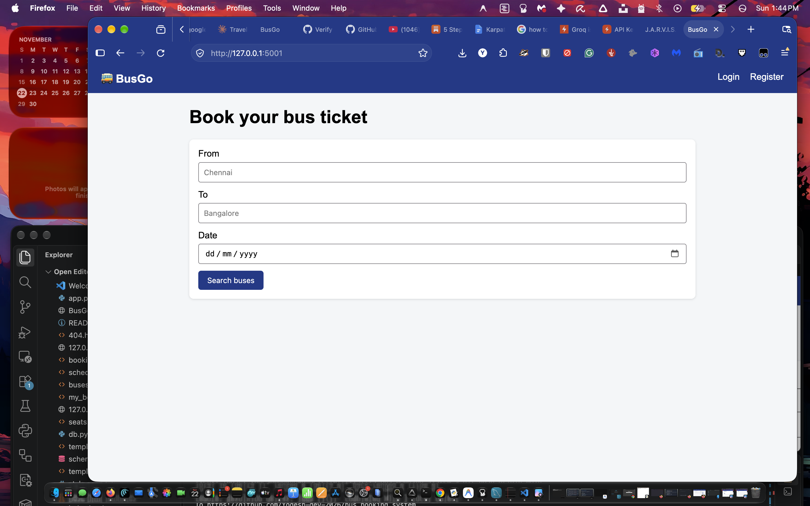
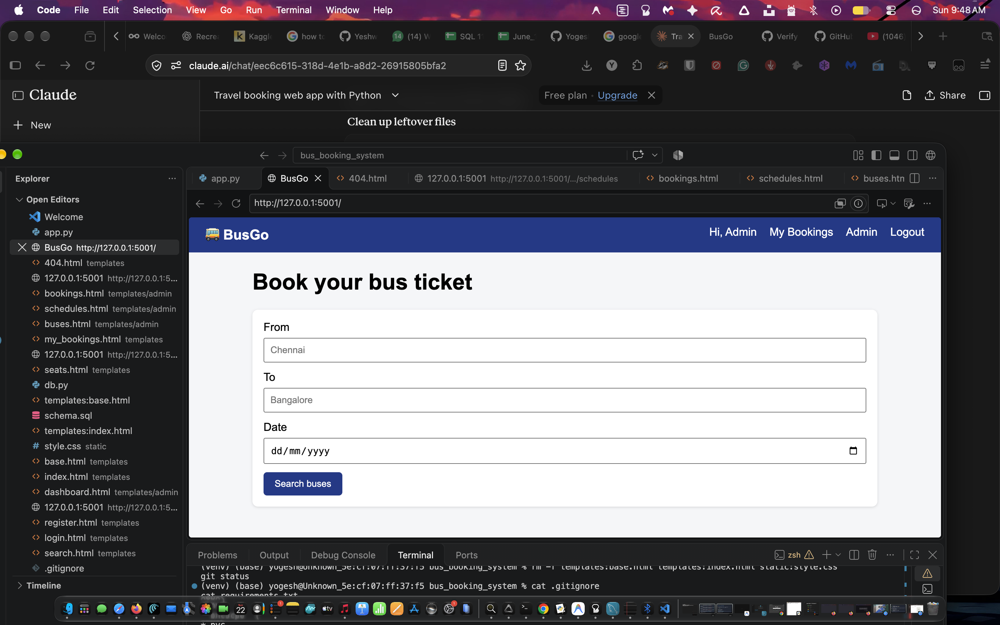
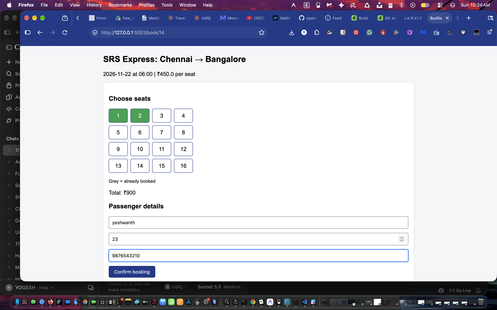
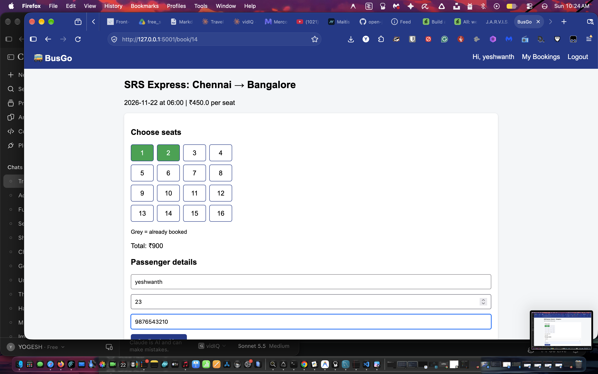
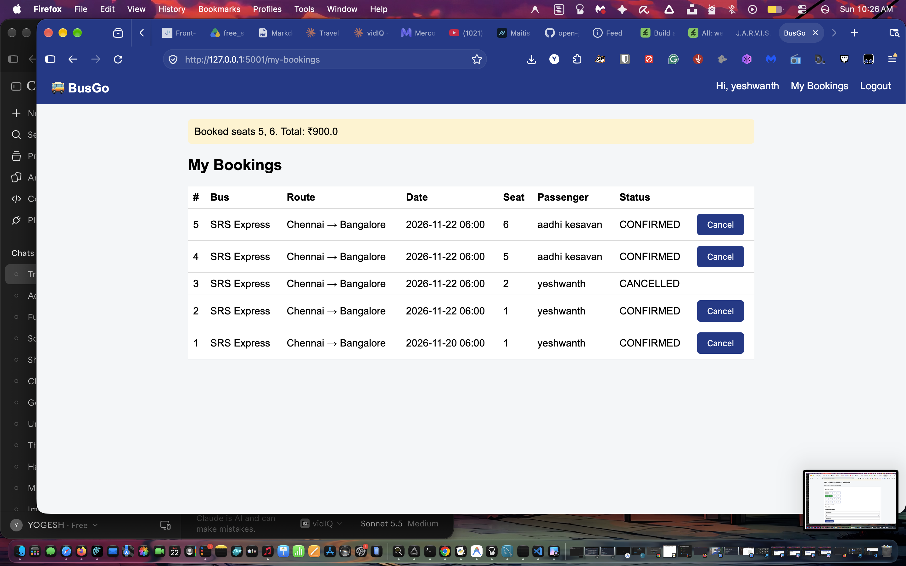
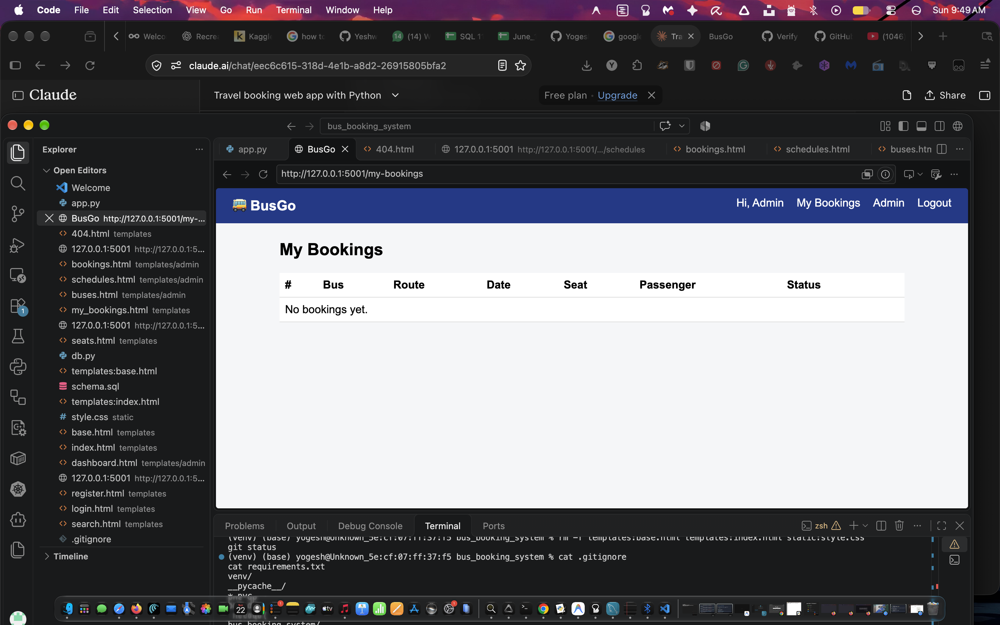
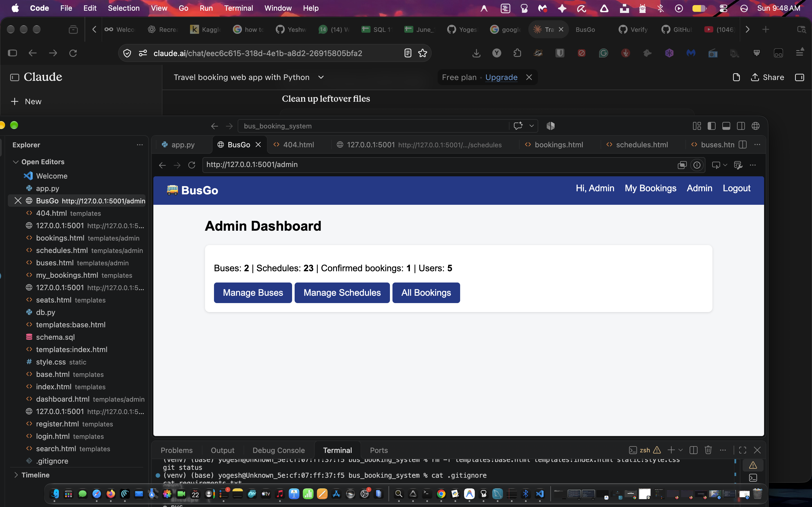
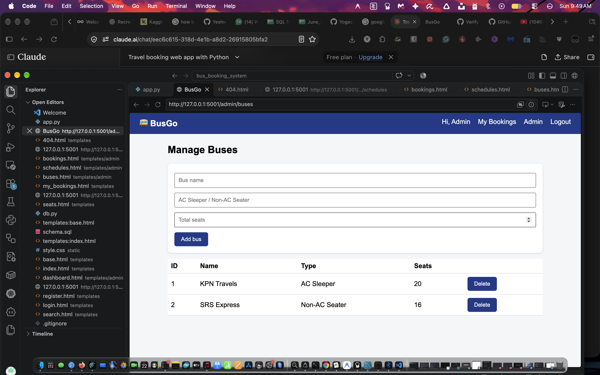
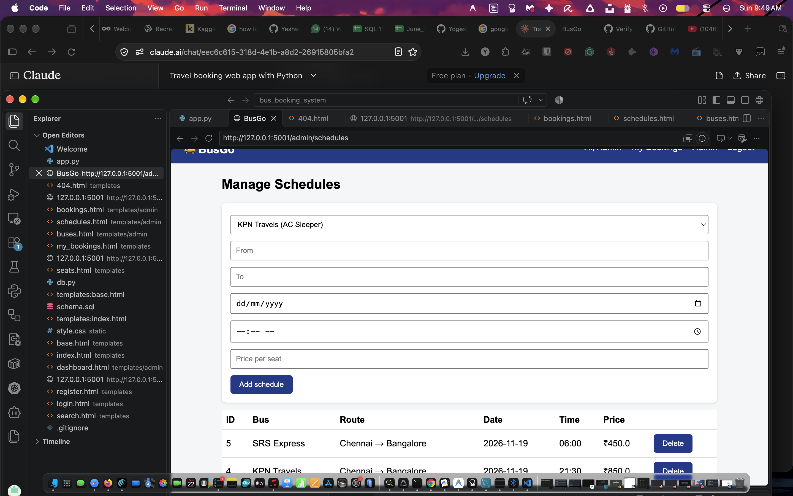
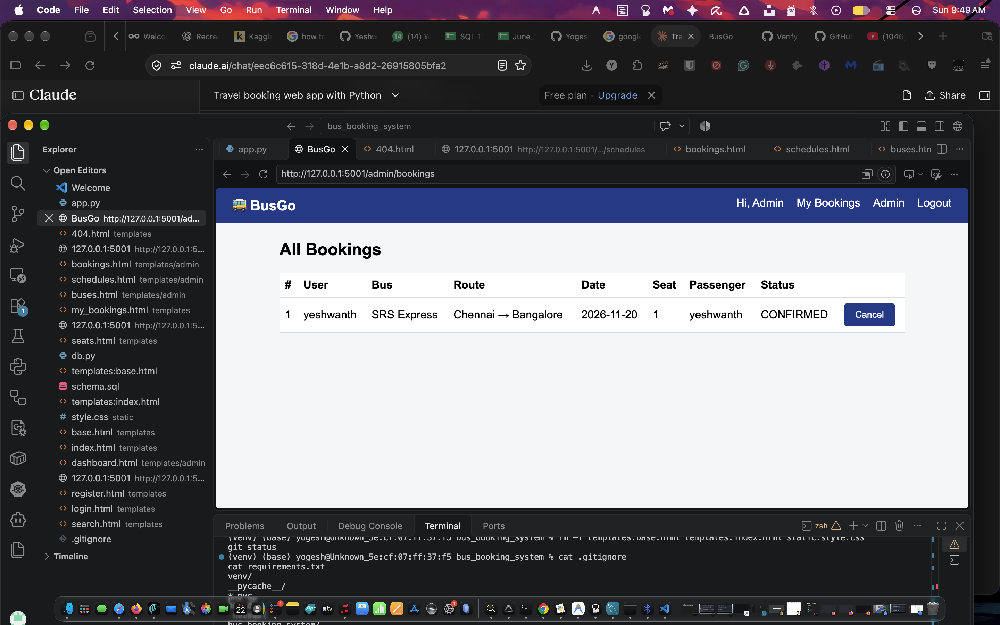

# BusGo – Bus Booking System

BusGo is a web-based bus booking application built using Python and Flask. Users can search for bus routes, select seats, enter passenger details, and book tickets. Administrators can manage buses, schedules, and bookings through an admin panel.

## Tech Stack

- **Backend:** Python 3, Flask
- **Database:** SQLite
- **Frontend:** HTML, CSS, JavaScript

## Features

### User Features
- User registration, login, and logout
- Password hashing for secure password storage
- Search buses by route and travel date
- View available seats and live seats-left count
- Select seats with already-booked seats blocked
- View live total ticket price
- Enter passenger details and book tickets
- View and cancel bookings through the My Bookings page

### Admin Features
- Admin dashboard
- Add and manage buses
- Manage bus schedules
- View all bookings
- Cancel bookings
- Custom 404 error page

## Screenshots

### Home Page
## Screenshots

### User Interface

**Home Page**

[](screenshots/home.png)

**Bus Search**

[](screenshots/homesearch.png)

**Seat Booking**

[](screenshots/seat_booking.png)

**Seat Selection – View 2**

[](screenshots/seats_booking_1.png)

**Seat Selection – View 3**

[](screenshots/seats_booking_2.png)

**My Bookings**

[](screenshots/my_bookings.png)

### Admin Panel

**Admin Dashboard**

[](screenshots/Admin.png)

**Manage Buses**

[](screenshots/my_buses.png)

**Manage Schedules**

[](screenshots/my_schedules.png)

**All Bookings**

[](screenshots/all_bookings.png)
## Run Locally

### 1. Clone the repository

```bash
git clone https://github.com/Yogesh-dev-2026/bus_booking_system.git
```

### 2. Navigate to the project directory

```bash
cd bus_booking_system
```

### 3. Create a virtual environment

```bash
python3 -m venv venv
```

### 4. Activate the virtual environment

**macOS / Linux:**
```bash
source venv/bin/activate
```

**Windows:**
```bash
venv\Scripts\activate
```

### 5. Install dependencies

```bash
pip install -r requirements.txt
```

### 6. Start the application

```bash
python app.py
```

Open the application in your browser:

http://127.0.0.1:5001

## Project Structure

```text
bus_booking_system/
│
├── app.py
├── db.py
├── schema.sql
├── requirements.txt
│
├── templates/
│   ├── admin/
│   └── other HTML templates
│
├── static/
│   └── style.css
│
├── screenshots/
│
└── README.md
```

## What I Learned

- Building web applications using Flask
- Handling routes and user sessions
- Implementing registration, login, and authentication
- Working with SQLite databases and SQL joins
- Validating user input through forms
- Managing bookings and seat availability
- Using Git and GitHub for version control

## Author

**Yogesh**

GitHub: [Yogesh-dev-2026](https://github.com/Yogesh-dev-2026)